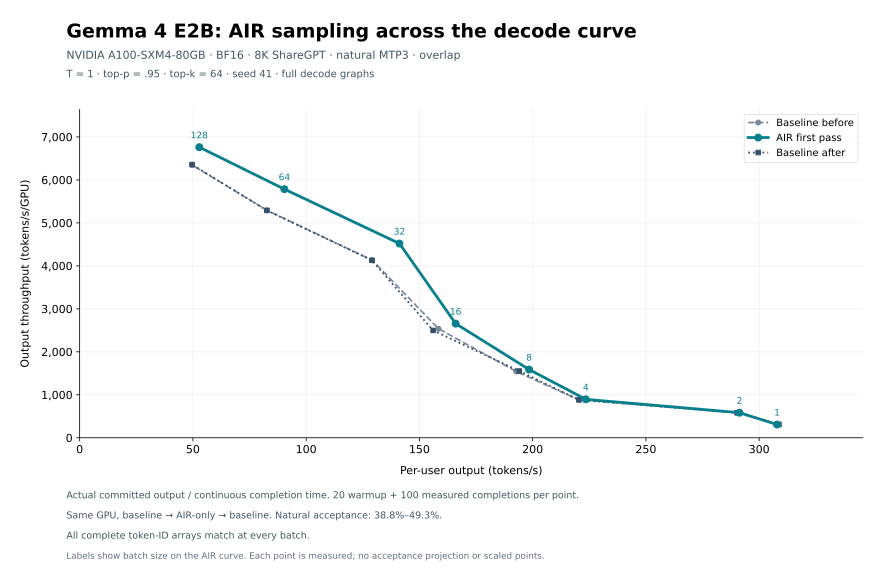
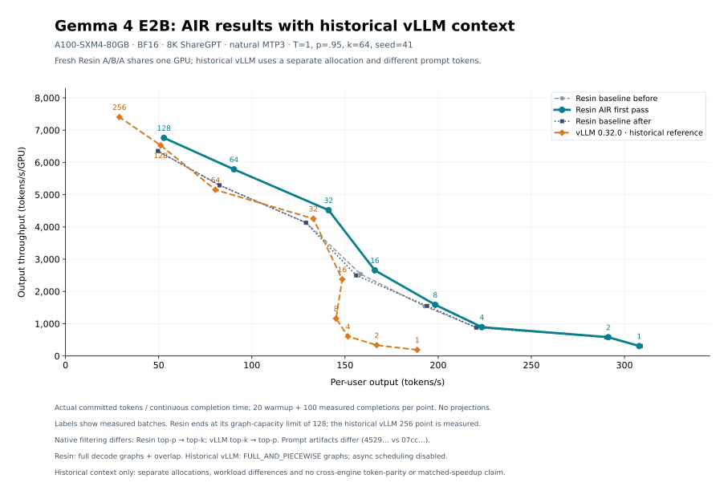

# AIR sampling performance

The AIR first-pass change reduces Gemma 4 E2B's mean decode completion interval
by **8.54–8.63% at batch 32**, from 18.796/18.813 ms in the two controls to
17.190 ms. Actual output throughput rises from 4,129–4,133 to **4,519 tokens/s**.
This is an AIR-only comparison: top-k, Python filtering and sampling remain the
same. Small batches show little benefit; these numbers are not a universal
sampling speedup.

[PNG](assets/gemma4-e2b-air-sampling.png) ·
[All 24 measured points and provenance](assets/gemma4-e2b-air-sampling.csv)

## Full-model measurement

One NVIDIA A100-SXM4-80GB runs baseline → clean AIR → baseline, with a fresh
model subprocess for each leg. All legs use BF16, 8,192-token ShareGPT prompts,
natural MTP with three draft tokens, temperature 1, top-p .95, top-k 64, seed 41,
full decode graphs and overlap. Every point has 20 warmup and 100 measured
completions. Timing covers continuous Engine completion intervals, including
intervening host work; loading, graph capture and prefill are outside the window.
These model runs do not request logprobs. Separate CUDA tests cover raw-logprob
preservation; Gemma's existing fallback for scored decoding with overlap is
unchanged.

| Batch | Baseline before, tokens/s | AIR, tokens/s | Baseline after, tokens/s | AIR completion latency reduction vs both controls |
|---:|---:|---:|---:|---:|
| 1 | 308.0 | 307.9 | 308.7 | −0.27% to −0.05% |
| 2 | 582.9 | 582.7 | 580.5 | −0.05% to +0.37% |
| 4 | 881.9 | 893.9 | 881.7 | +1.34% to +1.36% |
| 8 | 1,542.0 | 1,587.4 | 1,552.7 | +2.19% to +2.86% |
| 16 | 2,535.5 | 2,656.1 | 2,497.0 | +4.54% to +5.99% |
| 32 | 4,132.9 | 4,518.8 | 4,129.0 | +8.54% to +8.63% |
| 64 | 5,293.1 | 5,784.8 | 5,289.6 | +8.50% to +8.56% |
| 128 | 6,347.4 | 6,760.9 | 6,357.2 | +5.97% to +6.12% |

The horizontal axis is committed tokens / measured seconds / global batch;
the vertical axis is committed tokens / measured seconds / GPU count. No
acceptance projection or scaled points are used. Batch 128 is the current
Gemma full-decode graph capacity limit. These are eight measured points per leg,
not an extrapolation to batch 256.

At every batch, all three legs have identical timed committed counts, natural
acceptance and overlap counters. Each leg commits **60,048 timed tokens** across
the eight points. All **72,120 complete generated token IDs** per leg match
exactly, including output from prefill, warmup and pending retirement; there are
no length-only differences or token divergences. Those complete arrays are
collected outside timing. At batch 32, each leg commits 7,768 timed tokens with
47.5833% draft acceptance and 100 enqueues / 96 overlap continuations.

Baseline completion latency drifts by −0.69% to +1.54% across the eight points;
at batch 32 the drift is +0.095%. Gains are compared with both controls rather
than selecting the faster comparison. This is one paired sweep, not a repeated
allocation study. Full-model Hopper/Blackwell and prefill performance are
unmeasured here.

## Kernel checks and tradeoffs

The clean candidate passes **173 tests with zero skips or failures on each of
A100, H100 and B200**. The suite covers filtering and ties, request-local random
streams, mixed policies, graph replay with changed inputs, completion/overlap,
raw logprobs and the exact-cutoff certificate. The first pass uses private
histograms for large shapes; later radix passes keep the upstream algorithm.

For BF16 logits shaped batch 32 × width 4 × vocabulary 262,144, normal logits
and top-p .90, complete-sampler microbenchmarks give:

| GPU | Baseline control mean, µs | Clean AIR, µs | Reduction |
|---|---:|---:|---:|
| A100 SXM4 | 1,587.808 | 1,025.856 | 35.39% |
| H100 | 834.766 | 616.586 | 26.14% |
| B200 | 817.837 | 555.244 | 32.11% |

These are medians of five CUDA-event trials, each covering 16 CUDA-graph
invocations, after a one-second warmup. The baseline column averages the two
control medians. Clock samples are taken outside timing. This measures the
complete sampler separately from model completion time.

The same representative controls also expose roughly **2–6 µs extra work** on
greedy, temperature-only and top-k policies that do not need an active top-p
histogram. Distribution and shape matter: matching Gemma's numeric policy on
normal synthetic logits can skip AIR and show overhead, while real-model
batch-32 decoding improves as measured above. Retain these regressions when
assessing the optimization; a large top-p speedup does not imply every policy
gets faster.

A broader baseline → clean AIR → baseline sweep covers **576 cases per GPU**:
batch 1/8/32/128, width 1/4, vocabulary 32,768/201,088/262,144, BF16/FP32,
normal/peaked logits and six policies. All **60,840 last-replay token IDs** per
leg match exactly on each GPU, and all 173 CUDA tests pass in every leg. Each
case uses a 200 ms warmup followed by five trials of 16 graph invocations.
[All 1,728 comparisons](assets/air-sampling-micro.csv) retain both controls,
candidate latency, clock samples, control drift and token-match results.

For shapes using the new first pass (rows ≥16 and vocabulary ≥131,072), the
median complete-sampler latency reduction over 40 cases per policy is:

| Policy | A100 | H100 | B200 |
|---|---:|---:|---:|
| Greedy | −2.81% | −2.12% | −3.90% |
| Temperature only | −2.19% | −1.84% | −2.96% |
| Top-k 40 | −0.99% | −1.04% | −1.38% |
| Top-p .90 | +26.22% | +22.52% | +29.12% |
| Gemma: T1/p.95/k64 | +7.54% | +6.33% | +7.17% |
| Mixed requests | +40.21% | +33.19% | +34.68% |

Positive values mean lower latency against the mean of the two control medians.
The unweighted median across all 576 cases is slightly slower: 0.08% on A100,
0.47% on H100 and 0.13% on B200. The largest stable regression is **20.464 µs
(5.89%)** on B200 with 512 rows, vocabulary 262,144, FP32 peaked logits and
greedy sampling (347.354 → 367.818 µs). This is the cost of launching the larger
first-pass grid even when the rows have no active top-p work.

All cases remain in the CSV, including one small-shape A100 case with different
sampled clocks (1,140 MHz controls versus 1,410 MHz candidate) and an H100
fallback case with 4.4% control drift. No clock normalization is applied. The
policy medians describe this synthetic matrix, not an expected workload mix.

## Provenance

Measured on 2026-10-30 from base commit
`3a532d3eb8b527233391e89f16b0fc638f5bf622`. The only runtime source difference is
`resin/backend/cuda/sampling_air.cu`:

- Baseline SHA256: `a1e502d8674f4f07898c84da1efce4a34bd4193e7b13955b373042c1de01760f`.
- Clean SHA256: `1e86e979746532f227c7635d33e4aa33caaeec10aacf605cf05753924185bcf8`.
- Model sweep GPU UUID: `GPU-ba27c7c9-297c-b571-ffd7-3c7e1adf17ac`.
- Target checkpoint: `google/gemma-4-E2B-it` at `3e22461f65e89153144f8adb70e3b8c2cc9845a7`.
- Assistant checkpoint: `google/gemma-4-E2B-it-assistant` at `2d874ef7d29f9a30599a1e4b3c1cbc9595f005df`.
- Prompt artifact SHA256: `4529a0753da95ff2662019865d53ef621b80d9bb82a09a79a98a4029040797aa`.
- Raw model JSONL SHA256: `f67a271b60255df624811f0ad0f90327d0a51b5813e5c54b00038c612c088baa`.

Raw records, complete token arrays, test reports, source manifests and analysis
scripts are retained under `artifacts/air-pr/` in the research workspace. The
CSV preserves all measured rates, counts, intervals, counters and source hashes.
The analyzer uses `scripts/plot_bench.py`'s axes independently for each leg
without rewriting source metadata. Microbenchmarks use Torch 2.13.0, Triton
3.7.1, FlashInfer 0.7.1 and CUDA 13.0, with a current-core SHA256 of
`bd74121491783ffd86987056a3b7a5e790c7fdd00321b25e774f77500961cad1`.

## Historical vLLM reference

[PNG](assets/gemma4-e2b-air-vs-vllm.png) ·
[All 33 plotted measurements](assets/gemma4-e2b-air-vs-vllm.csv)

The companion retains all nine measured historical vLLM points, including batch
256, alongside the fresh AIR candidate and both paired Resin controls. Resin
ends at its measured graph-capacity limit of 128; no Resin batch-256 point is
extrapolated. Both axes use actual committed tokens and measured completion
intervals, with natural acceptance and no plot-only projection.

The historical run used **vLLM 0.32.0**, revision
`5df63a7203cdb9328d824a27b682e77c7b9928be`, on a separate **A100-SXM4-80GB**
allocation. It matches the pinned target/assistant checkpoints, BF16 weight/KV
precision, 8K prompt length, natural MTP3, and T1/p.95/k64/seed41 settings above.
It recorded 20 warmup and 100 measured completions per point. Decode was timed
as continuous synchronous engine completions; its graphs were
`FULL_AND_PIECEWISE`, and asynchronous scheduling was disabled. Fresh Resin uses
full decode graphs and overlap.

The prompt token artifacts differ: historical vLLM used SHA256
`07cc543695e56803083fa9e0a2033af046d47a24b30d987626a820ce046630a4`, while fresh
Resin used `4529a0753da95ff2662019865d53ef621b80d9bb82a09a79a98a4029040797aa`.
Their actual 8K token arrays also differ. Native sampling order differs as well:
vLLM applies top-k before top-p; Resin applies top-p before top-k. Natural
acceptance and generated outputs therefore need not agree between engines.
The exact token-parity evidence above applies to the three matched Resin legs.

This is a historical reference, with no matched cross-engine percentage claim.
For orientation, its measured batch-32/128/256 rates are 4,256/6,531/7,406
tokens/s. The underlying capped file has nine valid 8K decode points; all nine
were checked against the sampling, checkpoint, precision and timing metadata.
Raw file SHA256:
`8537ff999cd7e33901d09cf1b7b6c85954c3897bb134204ea6eebc7c96f00389`.
It is retained at
`artifacts/benchmarks/2026-10-27-gemma4-e2b-a100-80gb/vllm/sharegpt-sampling-capped.jsonl`
in the research workspace. The companion CSV records each raw-file hash,
source digest, prompt identity, filtering order and graph/scheduling policy.
